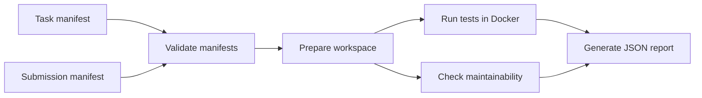

# Coding Evaluation Harness

`[](https://github.com/Yonasnegash/coding-eval-harness/actions/workflows/tests.yml)`

A small Python tool for running coding evaluations in a consistent, repeatable way.

The harness validates task and submission manifests, prepares an isolated workspace for each submission, runs tests inside Docker, and checks the code against a simple maintainability rubric. It then generates a JSON report containing the score and the evidence behind it.

## Why I built this

When evaluating code, a final score only tells part of the story. It's also useful to know which tests ran, what environment they ran in, and why the submission received its score.

I built this project to explore a straightforward way to make coding evaluations easier to reproduce and review. The goal isn't to replace human code review or build a full-scale evaluation platform. It's to make the evaluation process explicit, keep the results traceable, and avoid relying on scores that are difficult to explain.

## How it works

The evaluation follows a simple process:

1. Load and validate the task and submission manifests.
2. Copy the task workspace into a separate directory for the evaluation.
3. Place the submitted source code at the destination specified by the task.
4. Run the task's test command inside a restricted Docker container.
5. Check the source code against the maintainability rules.
6. Combine the results into a JSON report.

Each task defines its own runtime environment and test command, so the evaluation requirements are visible in the task configuration rather than hidden in the evaluator.



## Requirements

- Python 3.11 or later
- Docker Desktop configured to use Linux containers

## Installation

Clone the repository and install the project in editable mode:

```powershell
git clone https://github.com/Yonasnegash/coding-eval-harness.git
cd coding-eval-harness

python -m venv .venv
.venv\Scripts\Activate.ps1

python -m pip install -e .
```

To check that the CLI is available, run:

```powershell
eval-harness --help
```

On Windows, Application Control may block the generated `eval-harness.exe` launcher. If that happens, you can run the same CLI through Python:

```powershell
python -m eval_harness --help
```

## Running the example

The repository includes a simple example that evaluates a Python `add()` function.

Run it from the project root:

```powershell
python -m eval_harness `
  --tasks examples\tasks\tasks.jsonl `
  --submissions examples\submissions\submissions.jsonl `
  --report outputs\example-report.json `
  --runs-root .evaluation-runs
```

To inspect the results:

```powershell
Get-Content outputs\example-report.json
```

A submission that passes all the tests and satisfies every maintainability check receives 100 points:

- **Correctness:** 70 points
- **Maintainability:** 30 points

The report also includes the individual check results, so you can see how the score was calculated.

## Input format

The harness reads task and submission manifests in JSON Lines (JSONL) format. Each line contains one JSON object.

This keeps the input files easy to edit, review in Git, and process when evaluating multiple submissions.

### Task manifest

Example: `examples/tasks/tasks.jsonl`

```json
{
  "id": "sum-list",
  "workspace": "../workspaces/sum-list",
  "submission_target": "solution.py",
  "image": "python:3.12-alpine",
  "test_command": "python -m unittest discover -v",
  "maintainability": {
    "max_line_length": 100
  }
}
```

The task manifest defines what the evaluator needs to run:

| Field                 | Description                                                 |
| --------------------- | ----------------------------------------------------------- |
| `id`                | Unique identifier used to match the task with a submission. |
| `workspace`         | Directory containing the task's tests and starter files.    |
| `submission_target` | Relative path where the submitted source will be placed.    |
| `image`             | Docker image used to run the tests.                         |
| `test_command`      | Command executed inside the container.                      |
| `maintainability`   | Configuration for the source-code checks.                   |

### Submission manifest

Example: `examples/submissions/submissions.jsonl`

```json
{
  "task_id": "sum-list",
  "source_path": "../submissions/sum_list.py"
}
```

Each submission record identifies a task and the source file to evaluate.

The harness rejects duplicate task IDs rather than silently choosing one of the conflicting records. This avoids results changing simply because the records appear in a different order.

## Scoring

The evaluator assigns up to 100 points across correctness and maintainability.

Correctness carries the most weight because passing the task's tests is the primary requirement. The remaining points come from a small set of source-code checks.

| Check               |        Points | Rule                                       |
| ------------------- | ------------: | ------------------------------------------ |
| Correctness         |            70 | All task tests must pass.                  |
| Parseable source    |             5 | The source must parse as Python.           |
| Line length         |             6 | No line may exceed the configured limit.   |
| Function docstrings |             8 | Every function must have a docstring.      |
| No `TODO` marker  |             6 | The source must not contain a TODO marker. |
| No bare `except:` |             5 | Bare exception handlers are not allowed.   |
| **Total**     | **100** |                                            |

These checks are deliberately basic. They provide consistent signals that are easy to explain, but they don't measure everything that makes code maintainable. Things like good abstractions, meaningful naming, and architectural choices still require human judgment.

## Docker isolation

Each task runs in its own Docker container with a set of restrictions intended to limit what the submitted code can do.

| Option                               | Purpose                                                |
| ------------------------------------ | ------------------------------------------------------ |
| `--network none`                   | Disables network access from the container.            |
| `--read-only`                      | Makes the container's root filesystem read-only.       |
| `--cap-drop ALL`                   | Drops Linux capabilities.                              |
| `--security-opt no-new-privileges` | Prevents processes from gaining additional privileges. |
| `--memory 512m`                    | Limits memory usage to 512 MB.                         |
| `--cpus 1`                         | Limits CPU usage to one CPU.                           |
| `--pids-limit 64`                  | Limits the number of processes.                        |
| `--rm`                             | Removes the container after it exits.                  |

These settings provide a useful baseline for a prototype, but they shouldn't be treated as a complete security boundary for running hostile code.

A production evaluator handling submissions from multiple users would need stronger isolation and additional controls. Possible improvements include microVM-based execution, immutable image digests, secret redaction, queued jobs, and tighter control over generated artifacts.

## Evaluation report

The JSON report records both the result and the information needed to investigate it later.

Depending on the evaluation outcome, it includes:

- Task ID and evaluation status
- Correctness and maintainability scores
- Individual rubric checks and their explanations
- SHA-256 hash of the staged source code
- Docker image and test command
- Full Docker invocation
- Container exit code and execution duration
- Bounded standard output and standard error

This makes it possible to inspect why an evaluation passed or failed, compare results, and rerun the evaluation using the recorded inputs and environment.

The report is intended to make results easier to verify, not to imply that every score is an objective measure of code quality.

## Development

To run the test suite from the project root in PowerShell:

```powershell
$env:PYTHONPATH = "src"
python -m unittest discover -s tests -v
```

## Project structure

```text
src/eval_harness/
  manifest.py   # Reads and validates JSONL manifests
  staging.py    # Prepares isolated evaluation workspaces
  runner.py     # Runs tests through Docker
  rubric.py     # Applies maintainability checks
  service.py    # Coordinates the evaluation
  report.py     # Writes the JSON report
  cli.py        # Command-line interface

examples/
  tasks/        # Task manifests
  submissions/  # Submission manifests and source files
  workspaces/   # Tests and starter files for each task

tests/          # Unit and integration tests
```

## A few design choices

**The task defines its own runtime.** Different tasks may require different Python versions, dependencies, or test commands. Keeping those details in the task manifest makes the evaluation requirements easier to inspect and change.

**Every evaluation gets its own workspace.** The harness copies the original task workspace before staging the submission. This keeps the template untouched and prevents concurrent evaluations from writing into the same directory.

**The runner is replaceable.** The evaluation service depends on a runner interface rather than Docker-specific behavior. This makes it easier to test the orchestration logic with a fake runner without starting containers for every test.

**The report keeps the evidence.** Rather than returning only a score, the harness records the source hash, execution details, test output, and individual rubric results. A reviewer can use that information to understand the outcome instead of having to trust a number.

## What's next

There are a few areas I'd like to improve as the project grows:

- Add support for TypeScript, Java, and Go through language-specific task adapters.
- Pin Docker images by digest to make runtime environments more reproducible.
- Support named test groups for partial correctness scoring.
- Introduce human review and a process for resolving disagreements over borderline results.
- Explore microVM-based isolation for running untrusted submissions.
- Add structured log redaction and more durable artifact storage.

For now, the focus is on getting the fundamentals right: explicit evaluation requirements, isolated execution, deterministic checks, and reports that explain where the results came from.
